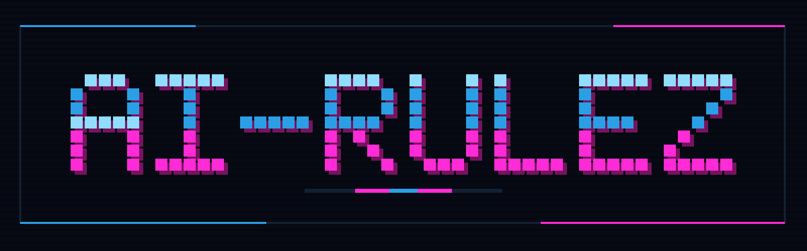

<p align="center">
  
</p>

<p align="center">
  <strong>One source for the rules, skills and settings of every AI coding assistant</strong>
</p>

<p align="center">
  <a href="https://www.npmjs.com/package/ai-rulez"></a>
  <a href="https://pypi.org/project/ai-rulez/"></a>
  <a href="https://github.com/Goldziher/homebrew-tap"></a>
  <a href="https://pkg.go.dev/github.com/Goldziher/ai-rulez/v5"></a>
  <a href="https://github.com/Goldziher/ai-rulez/actions/workflows/ci.yaml"></a>
  <a href="https://github.com/Goldziher/ai-rulez/blob/main/LICENSE"></a>
  <a href="https://goldziher.github.io/ai-rulez/"></a>
</p>

<p align="center">
  <a href="https://goldziher.github.io/ai-rulez/"><strong>Documentation</strong></a> &middot;
  <a href="https://goldziher.github.io/ai-rulez/quick-start/"><strong>Quick Start</strong></a> &middot;
  <a href="https://goldziher.github.io/ai-rulez/examples/"><strong>Examples</strong></a>
</p>


---

## What it is

ai-rulez keeps the instructions for your AI coding assistants in one directory, `.ai-rulez/`: rules, context, skills,
agents, commands, hooks, permissions and MCP servers. From that source it generates the native files of each assistant
your team uses (`AGENTS.md`, `CLAUDE.md`, `.cursor/rules/`, `.github/instructions/`, skill folders, MCP and settings
files) for 52 tools, and keeps them in sync.

- **One source, every tool.** Edit `.ai-rulez/`, run `generate`, and Claude Code, Cursor, Codex, Copilot, Gemini CLI
  and the rest get the same guidance in their own format.
- **Checked in CI.** `generate --check` catches drift; `validate` lints content, links and security issues with stable
  `AR` rule codes, and also works on plain `AGENTS.md` and `SKILL.md` files with no configuration.
- **Governed like dependencies.** A lock file pins remote includes, installed skills and authored content; approvals,
  Sigstore signatures, SBOMs and an organization policy cover the rest.
- **Packaged for distribution.** Build plugin bundles and marketplaces, Agent Plugins and ARD manifests, and publish
  them.

## 30-second example

```bash
npx ai-rulez@latest init acme
```

Set the tools you use in `.ai-rulez/config.toml`:

```toml
version = "5.0"
name = "acme"
presets = ["claude", "cursor", "codex", "copilot", "gemini"]
```

Add a rule and generate:

```bash
npx ai-rulez@latest add rule testing --content '# Testing

- Every bug fix ships with a regression test.'
npx ai-rulez@latest generate
```

```text
AGENTS.md                # rules and context, read by Codex, Cursor, Copilot and Gemini CLI
CLAUDE.md                # imports @AGENTS.md for Claude Code
.agents/skills/          # skills
.claude/skills/
.gemini/settings.json    # points Gemini CLI at AGENTS.md
.mcp.json, .cursor/mcp.json, .vscode/mcp.json, .codex/config.toml
```

Commit `.ai-rulez/` with the generated files, and add `ai-rulez generate --check` to CI. The
[Quick start](https://goldziher.github.io/ai-rulez/quick-start/) walks through it in five minutes.

<p align="center">
  
</p>

## Install

```bash
brew install goldziher/tap/ai-rulez                                # Homebrew (macOS, Linux)
npm install -g ai-rulez                                            # npm (Node.js 22+)
pipx install ai-rulez                                              # PyPI (Python 3.11+); or uv tool install ai-rulez
go install github.com/Goldziher/ai-rulez/v5/cmd/ai-rulez@latest    # Go (note the /v5)
```

Or run it without installing: `npx ai-rulez@latest <command>` or `uvx ai-rulez <command>`. See
[Installation](https://goldziher.github.io/ai-rulez/installation/) for platforms, shell completion and git hooks.

## Supported tools

52 built-in presets, one per assistant, CLI agent or IDE integration. Combine any of them in `presets = [...]`;
[Supported harnesses](https://goldziher.github.io/ai-rulez/harnesses/) shows which rules, skills, agents, commands, MCP servers, hooks and permissions
each one receives. A tool that is not listed can be added as a [custom preset](https://goldziher.github.io/ai-rulez/profiles/).

<details>
<summary><strong>All 52 built-in presets</strong></summary>

| Preset | Tool |
| ------ | ---- |
| `aiassistant` | [JetBrains AI Assistant](https://www.jetbrains.com/help/ai-assistant/) |
| `amp` | [Sourcegraph Amp](https://ampcode.com) |
| `antigravity` | [Google Antigravity](https://antigravity.google/docs) |
| `augment` | [Augment Code](https://docs.augmentcode.com) |
| `baz` | [Baz](https://baz.ai/docs/agents/skills-and-instructions) |
| `bob` | [IBM Bob](https://bob.ibm.com/docs) |
| `claude` | [Claude Code](https://code.claude.com/docs) |
| `cline` | [Cline](https://docs.cline.bot) |
| `codebuddy` | [CodeBuddy Code](https://www.codebuddy.ai/docs/cli) |
| `codebuff` | [Codebuff](https://www.codebuff.com/docs) |
| `codewhale` | [Codewhale](https://github.com/codewhale-hq/Codewhale) |
| `codex` | [OpenAI Codex](https://developers.openai.com/codex) |
| `commandcode` | [Command Code](https://commandcode.ai/docs) |
| `copilot` | [GitHub Copilot](https://docs.github.com/en/copilot) |
| `copilot-cli` | [GitHub Copilot CLI](https://docs.github.com/en/copilot/how-tos/copilot-cli) |
| `cortex` | [Snowflake Cortex Code](https://docs.snowflake.com/en/user-guide/cortex-code/extensibility) |
| `crush` | [Crush](https://github.com/charmbracelet/crush) |
| `cursor` | [Cursor](https://cursor.com/docs) |
| `deepagents` | [Deep Agents Code](https://docs.langchain.com/oss/deepagents/code) |
| `devin` | [Devin CLI](https://docs.devin.ai/cli) |
| `dsh` | [DeepSeek Harness](https://github.com/deepseek-ai/deepseek-harness) |
| `factory` | [Factory Droid](https://docs.factory.ai) |
| `gemini` | [Gemini CLI](https://geminicli.com/docs/) |
| `gitlab-duo` | [GitLab Duo CLI](https://docs.gitlab.com/user/gitlab_duo_cli/customize/) |
| `goose` | [goose](https://goose-docs.ai) |
| `grok` | [Grok Build CLI](https://docs.x.ai/build/overview) |
| `hermes` | [Hermes Agent](https://hermes-agent.nousresearch.com/docs) |
| `junie` | [JetBrains Junie](https://junie.jetbrains.com) |
| `kilo` | [Kilo Code](https://kilo.ai/docs) |
| `kimi` | [Kimi Code](https://moonshotai.github.io/kimi-code/) |
| `kiro` | [Kiro](https://kiro.dev/docs) |
| `letta` | [Letta Code](https://docs.letta.com) |
| `mimocode` | [MiMo Code](https://mimo.xiaomi.com/mimocode) |
| `muse` | [Meta Muse Code](https://dev.meta.ai/docs/muse-code) |
| `omp` | [oh-my-pi](https://github.com/can1357/oh-my-pi) |
| `openclaw` | [OpenClaw](https://docs.openclaw.ai) |
| `opencode` | [OpenCode](https://opencode.ai/docs) |
| `pi` | [pi](https://pi.dev/docs/latest) |
| `poolside` | [Poolside Pool](https://docs.poolside.ai) |
| `qoder` | [Qoder](https://docs.qoder.com/cli/quickstart) |
| `qwen` | [Qwen Code](https://qwenlm.github.io/qwen-code-docs/en/) |
| `reasonix` | [Reasonix](https://github.com/esengine/DeepSeek-Reasonix) |
| `replit` | [Replit Agent](https://docs.replit.com/features/agent/overview) |
| `rovodev` | [Atlassian Rovo Dev](https://www.atlassian.com/software/rovo-dev) |
| `takt` | [Takt](https://github.com/nrslib/takt) |
| `trae` | [Trae](https://docs.trae.ai/ide/rules) |
| `vibe` | [Mistral Vibe](https://docs.mistral.ai/vibe) |
| `warp` | [Warp](https://docs.warp.dev) |
| `xum` | [Xum](https://xum.coder.com) |
| `zcode` | [ZCode](https://zcode.z.ai/en/docs) |
| `zed` | [Zed](https://zed.dev/docs/ai) |
| `zoocode` | [Zoo Code](https://docs.zoocode.dev) |

</details>

## What else it does

| Area | Commands | Docs |
| ---- | -------- | ---- |
| Author | `add`, `edit`, `show`, `list`, `remove`, `domain`, `profile`, `include`, `skill install` | [Configuration](https://goldziher.github.io/ai-rulez/configuration/), [Rules](https://goldziher.github.io/ai-rulez/rules/), [Skills](https://goldziher.github.io/ai-rulez/skills/), [Includes](https://goldziher.github.io/ai-rulez/includes/) |
| Import | `init --from auto`, `convert`, `migrate v5` | [CLI](https://goldziher.github.io/ai-rulez/cli/), [Migrating to v5](https://goldziher.github.io/ai-rulez/migration-v5/) |
| Generate | `generate`, `generate --user`, `generate --recursive`, `generate --watch`, `clean` | [Harnesses](https://goldziher.github.io/ai-rulez/harnesses/), [Hooks and settings](https://goldziher.github.io/ai-rulez/settings/), [Monorepo](https://goldziher.github.io/ai-rulez/monorepo/) |
| Validate | `validate`, `scan`, `verifiers run`, `judge`, `review` | [Strict validation](https://goldziher.github.io/ai-rulez/strict-validation/), [Verifiers](https://goldziher.github.io/ai-rulez/verifiers/), [Judge](https://goldziher.github.io/ai-rulez/judge/) |
| Govern | `lock`, `update`, `approve`, `sign`, `verify`, `sbom` | [Lock file](https://goldziher.github.io/ai-rulez/lockfile/), [Signing](https://goldziher.github.io/ai-rulez/signing/), [Policy](https://goldziher.github.io/ai-rulez/policy/) |
| Bundle and publish | `generate --plugin`, `verify --plugin`, `publish` | [Plugins](https://goldziher.github.io/ai-rulez/plugins/), [Publish](https://goldziher.github.io/ai-rulez/publish/) |
| Operate | `mcp --serve-skills`, `search`, `eval`, `tokens`, `cost`, `catalog`, `telemetry` | [MCP server](https://goldziher.github.io/ai-rulez/mcp-server/), [Evals](https://goldziher.github.io/ai-rulez/evals/) |
| Embed | `pkg/airulez` | [Go API](https://goldziher.github.io/ai-rulez/embedding/) |

`validate --strict` flags a defect, `--explain` describes it, and `generate --check` fails on drift:

<p align="center">
  
</p>

`verify --plugin` reports hand-edited or stray files in a plugin bundle, and `generate --plugin` restores it:

<p align="center">
  
</p>

Skills served over MCP cost no context until an assistant asks for them:

<p align="center">
  
</p>

In a monorepo, `generate --recursive` and `validate --recursive` process every nested `.ai-rulez/`:

<p align="center">
  
</p>

## How it compares

Static checks of `ai-rulez scan` against other open-source skill scanners, on a public dataset we did not write:

<!-- skillbench:start -->

1384 skills (839 malicious, 545 benign) from the MaliciousSkillBench source-disjoint `test` partition, static, text-only, no LLM. Scored on each tool's own verdict; intervals are 95% clustered bootstrap.

| Tool | Version | Recall | False-positive rate | Precision | F1 |
| ---- | ------- | ------ | ------------------- | --------- | -- |
| ai-rulez | 5.11.1 | 0.195 (0.139-0.271) | 0.338 (0.297-0.378) | 0.471 | 0.276 (0.210-0.354) |
| skill-scanner | 2.3.2 | 0.077 (0.044-0.125) | 0.040 (0.025-0.058) | 0.747 | 0.140 (0.082-0.216) |
| skillspector | 2.13.4 | 0.113 (0.073-0.167) | 0.194 (0.161-0.228) | 0.473 | 0.183 (0.124-0.254) |

<!-- skillbench:end -->

That table is the last held-out read, of release 5.11.1. Unreleased changes are measured only on the `dev` partition,
which rule changes are tuned on, so expect lower numbers on held-out sources. `ai-rulez-threat` is
`scan --fail-on threat`, the gate to compare with the other scanners; `ai-rulez` is `--fail-on warning`:

<!-- skillbench-dev:start -->

8213 skills (6523 malicious, 1690 benign) from the MaliciousSkillBench source-disjoint `dev` partition, static, text-only, no LLM. Scored on each tool's own verdict; intervals are 95% clustered bootstrap.

| Tool | Version | Recall | False-positive rate | Precision | F1 |
| ---- | ------- | ------ | ------------------- | --------- | -- |
| ai-rulez-threat | unreleased | 0.225 (0.209-0.242) | 0.007 (0.004-0.011) | 0.992 | 0.367 (0.345-0.389) |
| ai-rulez | unreleased | 0.437 (0.420-0.454) | 0.074 (0.062-0.087) | 0.958 | 0.600 (0.584-0.616) |
| skill-scanner | 2.3.2 | 0.312 (0.298-0.326) | 0.008 (0.004-0.013) | 0.993 | 0.475 (0.459-0.491) |
| skillspector | 2.13.4 | 0.323 (0.306-0.339) | 0.155 (0.138-0.173) | 0.889 | 0.473 (0.455-0.492) |

<!-- skillbench-dev:end -->

And on real, widely used skills, where every flag is a false alarm:

<!-- skillbench-clean:start -->

563 real skills from the `clean` track, all treated as benign, static, text-only, no LLM. A flag is a false alarm.

| Tool | Version | Skills flagged | Share flagged |
| ---- | ------- | -------------- | ------------- |
| ai-rulez-threat | unreleased | 12 of 563 | 2.1% (1.1-3.4) |
| ai-rulez | unreleased | 53 of 563 | 9.4% (7.1-11.9) |
| skill-scanner | 2.3.2 | 26 of 563 | 4.6% (3.0-6.4) |
| skillspector | 2.13.4 | 167 of 563 | 29.7% (25.9-33.4) |

<!-- skillbench-clean:end -->

Every number is reproducible with one command. See [Scanner benchmark](https://goldziher.github.io/ai-rulez/benchmarks/)
for the protocol and its limits.

## Standards

ai-rulez generates and validates AGENTS.md, Agent Skills, Agent Plugins, ARD, llms.txt, OKF (the format of
`.ai-rulez/` itself), MCP server configuration and Server Cards, CycloneDX and SPDX SBOMs, and in-toto/DSSE
attestations in Sigstore bundles. [Standards conformance](https://goldziher.github.io/ai-rulez/standards/) lists the versions, the conformance tests
and the known gaps.

## CI and git hooks

GitHub Actions:

```yaml
steps:
  - uses: actions/checkout@v7
  - uses: Goldziher/ai-rulez@v5
    with:
      version: 5.12.0
  - run: ai-rulez generate --check
  - run: ai-rulez validate
```

See [GitHub Actions](https://goldziher.github.io/ai-rulez/github-actions/) for the full workflow and the governance gate.

pre-commit or prek:

```yaml
repos:
  - repo: https://github.com/Goldziher/ai-rulez
    rev: v5.12.0
    hooks:
      - id: ai-rulez-recursive
      - id: ai-rulez-validate
```

See [GitHub Actions](https://goldziher.github.io/ai-rulez/github-actions/) for the governance gate and scheduled pin
updates, and [Installation](https://goldziher.github.io/ai-rulez/installation/#git-hooks) for Lefthook, Poly and `init --setup-hooks`.

## Upgrading from 4.x

Run `ai-rulez migrate v5 --dry-run`, then follow [Migrating to v5](https://goldziher.github.io/ai-rulez/migration-v5/).

## Documentation

Full documentation: [goldziher.github.io/ai-rulez](https://goldziher.github.io/ai-rulez/). Contributors: see
[CONTRIBUTING.md](CONTRIBUTING.md) and [Architecture](https://goldziher.github.io/ai-rulez/architecture/).

## License

[MIT](LICENSE)
