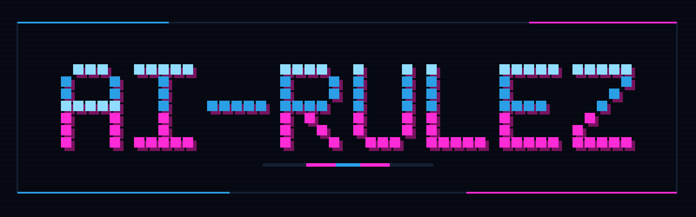

# AI-Rulez

<p align="center">
  
</p>

AI-Rulez keeps the instructions for your AI coding assistants in one place, `.ai-rulez/`, and generates the native
files of 52 assistants from it. You edit one source; `AGENTS.md`, `CLAUDE.md`, `.cursor/rules/`,
`.github/instructions/`, skill folders, MCP and settings files follow. AI-Rulez also validates that content, pins and
signs it, and packages it as plugins.

## How it works

You write rules, context, skills, agents and commands as Markdown files and list the tools you use in
`.ai-rulez/config.toml`:

```toml
version = "5.0"
name = "acme"
presets = ["claude", "cursor", "codex", "copilot", "gemini"]
```

`ai-rulez generate` renders each tool's own layout from that one source:

```text
acme/
├── .ai-rulez/              # the source you edit
│   ├── config.toml
│   ├── rules/
│   ├── context/
│   └── skills/
├── AGENTS.md               # read by Codex, Cursor, Copilot and Gemini CLI
├── CLAUDE.md               # imports @AGENTS.md
├── .agents/skills/         # skills for tools that read .agents/skills
├── .claude/skills/         # skills for Claude Code
├── .gemini/settings.json   # points Gemini CLI at AGENTS.md
├── .mcp.json, .cursor/mcp.json, .vscode/mcp.json, .codex/config.toml
└── ...
```

Change the source, run `generate` again, and every tool stays in sync. `ai-rulez generate --check` fails in CI when
the committed files drift from the source.

## Get started

1. [Install](installation.md) the CLI, or run it with `npx ai-rulez@latest` or `uvx ai-rulez`.
2. Follow the [Quick start](quick-start.md): `init`, choose presets, add a rule, `generate`.
3. Commit `.ai-rulez/` together with the generated files.

Already have a `CLAUDE.md`, `AGENTS.md` or `.cursor/rules/`? `ai-rulez init --from auto` imports them. Upgrading a
4.x project? See [Migrating to v5](migration-v5.md).

## What you can do

| Area | What you do | Start with |
| ---- | ----------- | ---------- |
| **Author** | Write rules, context, skills, agents, commands and review checks; organize them with domains, profiles, roles and shared includes. | [Configuration](configuration.md), [Rules](rules.md), [Skill frontmatter](skills.md), [Domains and profiles](domains.md) |
| **Generate** | Render native files for 52 assistants, per project or in your home directory, with hooks, permissions and MCP servers translated for each. | [Supported harnesses](harnesses.md), [AGENTS.md](agents-md.md), [Hooks and settings](settings.md) |
| **Bundle and publish** | Package plugins and marketplaces, Agent Plugins and ARD manifests, and release them to GitHub, npm or OCI. | [Authoring plugins](plugins.md), [Publish](publish.md) |
| **Validate** | Lint configured projects, or plain `AGENTS.md`, `SKILL.md` and `.claude/` files with no configuration, using stable `AR` rule codes; catch harness traps; run repository verifiers in CI and git hooks. | [Strict validation](strict-validation.md), [Harness traps](harness-traps.md), [Verifiers](verifiers.md), [GitHub Actions](github-actions.md) |
| **Govern** | Pin sources and content in a lock file, record reviewer approvals, sign with Sigstore, enforce an organization policy and produce an SBOM. | [Trust model](trust-model.md), [Lock file](lockfile.md), [Signing](signing.md) |
| **Operate** | Serve configuration and skills over MCP, search skills, run evals, improve skills, review changes with a model and export telemetry. | [MCP server](mcp-server.md), [Evals](evals.md), [Review](review.md), [Judge](judge.md) |

The formats ai-rulez writes (AGENTS.md, Agent Skills, Agent Plugins, OKF, llms.txt, CycloneDX, SPDX, in-toto and
others) are checked against each standard's own schema or rules; [Standards conformance](standards.md) lists the
versions and known gaps.

## Reference

- [CLI commands](cli.md) and the generated [CLI command reference](cli-reference.md).
- [Schema](schema.md): JSON schemas of the configuration and of every `--format json` report.
- [Architecture](architecture.md): how a source becomes generated files, and the package layout.
- [Standards conformance](standards.md): the open formats ai-rulez writes and how each is checked.
- [Embedding (Go API)](embedding.md): load, validate, plan and apply generation from Go.
- [Changelog](CHANGELOG.md).

## Getting help

- `ai-rulez --help` and `ai-rulez <command> --help` describe every command and flag.
- `ai-rulez validate --explain AR001` explains a rule code and how to suppress it.
- `ai-rulez doctor` diagnoses a project (drift, removed presets, missing tools) without changing anything.
- Report problems on [GitHub](https://github.com/Goldziher/ai-rulez/issues).

This documentation covers ai-rulez v5 (`version = "5.0"` in `config.toml`).
