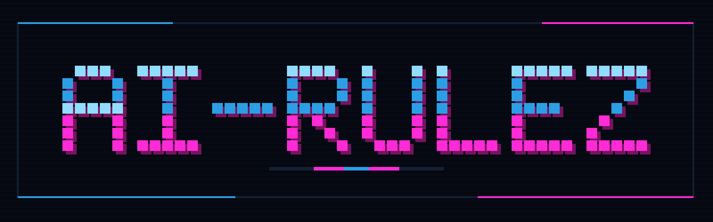

<p align="center">
  
</p>

# ai-rulez

[](https://www.npmjs.com/package/ai-rulez)
[](https://github.com/Goldziher/ai-rulez/blob/main/LICENSE)

One source for the rules, skills and settings of every AI coding assistant. ai-rulez keeps them in a single `.ai-rulez/` directory and generates the native files of 52 tools (`AGENTS.md`, `CLAUDE.md`, `.cursor/rules/`, skills, MCP and settings files), then validates, locks, signs and publishes them.

Documentation: [goldziher.github.io/ai-rulez](https://goldziher.github.io/ai-rulez/)

## Install

Requires Node.js 22 or newer.

```bash
npm install -g ai-rulez
```

Or run it without installing:

```bash
npx ai-rulez@latest init acme
```

The package is a thin launcher for the `ai-rulez` Go binary. On the first run it downloads the binary for your platform
(Linux and macOS on amd64 and arm64, Windows on amd64) from the matching GitHub release, verifies its SHA-256 checksum,
and stores it inside the package. Later runs start it directly.

## Quickstart

```bash
ai-rulez init acme
ai-rulez add rule testing --content '# Testing

- Every bug fix ships with a regression test.'
ai-rulez generate
```

Set the tools you use in `.ai-rulez/config.toml` with `presets = ["claude", "cursor", "codex"]`. Run
`ai-rulez generate --check` in CI to catch drift. The
[Quick start](https://goldziher.github.io/ai-rulez/quick-start/) covers the rest.

## Private registries and offline installs

To avoid the GitHub download, publish the package with binaries in `bin/` named `ai-rulez-linux-amd64`,
`ai-rulez-linux-arm64`, `ai-rulez-darwin-amd64`, `ai-rulez-darwin-arm64` or `ai-rulez-windows-amd64.exe`. The launcher
uses a packaged binary first. If the Windows binary needs `liter_llm_ffi.dll`, add it as `bin/liter_llm_ffi.dll`.

## Other channels

Homebrew (`brew install goldziher/tap/ai-rulez`), PyPI (`pipx install ai-rulez` or `uv tool install ai-rulez`) and Go
(`go install github.com/Goldziher/ai-rulez/v5/cmd/ai-rulez@latest`). See
[Installation](https://goldziher.github.io/ai-rulez/installation/).

## Links

[Documentation](https://goldziher.github.io/ai-rulez/) · [Source](https://github.com/Goldziher/ai-rulez) ·
[Issues](https://github.com/Goldziher/ai-rulez/issues) · [MIT license](https://github.com/Goldziher/ai-rulez/blob/main/LICENSE)
