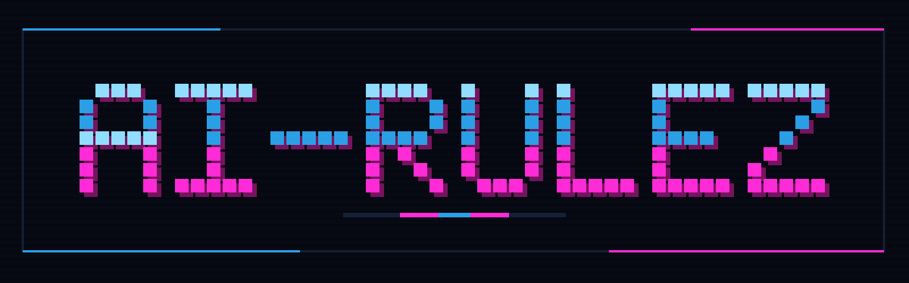

<p align="center">
  
</p>

# ai-rulez

[](https://pypi.org/project/ai-rulez/)
[](https://github.com/Goldziher/ai-rulez/blob/main/LICENSE)

One source for the rules, skills and settings of every AI coding assistant. ai-rulez keeps them in a single `.ai-rulez/` directory and generates the native files of 52 tools (`AGENTS.md`, `CLAUDE.md`, `.cursor/rules/`, skills, MCP and settings files), then validates, locks, signs and publishes them.

Documentation: [goldziher.github.io/ai-rulez](https://goldziher.github.io/ai-rulez/)

## Install

Requires Python 3.11 or newer.

```bash
pipx install ai-rulez     # or: uv tool install ai-rulez, pip install ai-rulez
```

Or run it without installing:

```bash
uvx ai-rulez init acme
```

The package is a thin launcher for the `ai-rulez` Go binary and installs the `ai-rulez` command. On the first run it
downloads the binary for your platform (Linux and macOS on amd64 and arm64, Windows on amd64) from the GitHub release
that matches the package version, verifies its SHA-256 checksum and caches it in `~/.cache/ai-rulez`. It is
re-downloaded when the package version changes.

## Quickstart

```bash
ai-rulez init acme
ai-rulez add rule testing --content '# Testing

- Every bug fix ships with a regression test.'
ai-rulez generate
```

Set the tools you use in `.ai-rulez/config.toml` with `presets = ["claude", "cursor", "codex"]`. Run
`ai-rulez generate --check` in CI to catch drift. The
[Quick start](https://goldziher.github.io/ai-rulez/quick-start/) covers the rest.

## Other channels

Homebrew (`brew install goldziher/tap/ai-rulez`), npm (`npm install -g ai-rulez`) and Go
(`go install github.com/Goldziher/ai-rulez/v5/cmd/ai-rulez@latest`). See
[Installation](https://goldziher.github.io/ai-rulez/installation/).

## Links

[Documentation](https://goldziher.github.io/ai-rulez/) · [Source](https://github.com/Goldziher/ai-rulez) ·
[Issues](https://github.com/Goldziher/ai-rulez/issues) · [MIT license](https://github.com/Goldziher/ai-rulez/blob/main/LICENSE)
